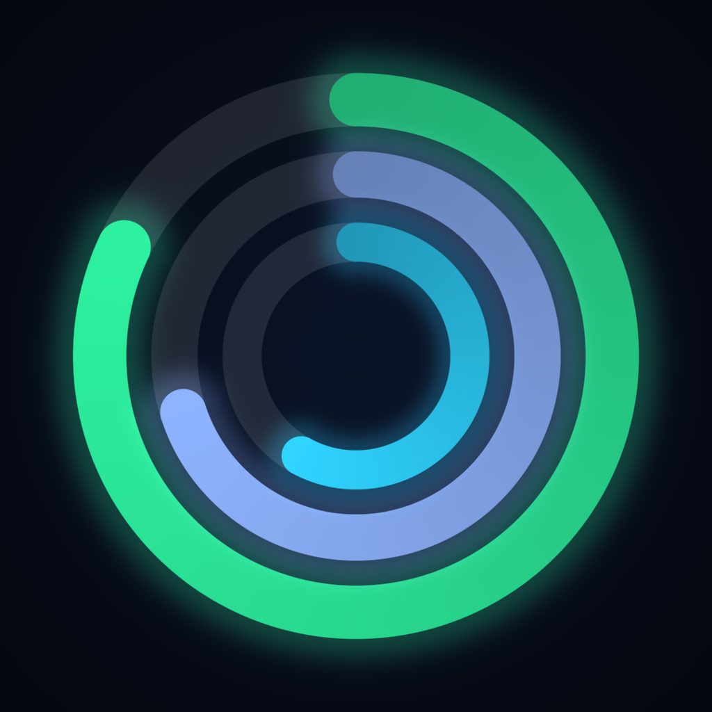

<p align="center">
  
</p>

<h1 align="center">Lumen</h1>

<p align="center">
  <b>Recovery, Strain and Sleep coaching for the Apple Watch you already own.</b><br>
  Open source · no subscription · no extra hardware · your data never leaves your iPhone.
</p>

---

Lumen turns the heart rate, HRV, sleep stages, respiratory rate and workouts your Apple Watch already records into daily scores you can act on — wrapped in an iOS 26 Liquid Glass interface.

## Features

| | |
|---|---|
| **Recovery** 0–100 % | Overnight HRV, resting heart rate, respiratory rate and sleep, compared with *your own* 30-day baseline. Green / yellow / red, with a strain target for the day. |
| **Strain** 0–21 | Cardiovascular load from minute-by-minute heart rate (Banister TRIMP), heart-rate zones, strength time, steps, per-workout strain. |
| **Sleep** | Sleep need for tonight (goal + yesterday's strain + sleep debt), performance, consistency, efficiency, restorative sleep, stage hypnogram, recommended bedtime. |
| **Stress Monitor** | 0–3 stress estimate through the day from heart rate relative to your resting baseline. |
| **Health Monitor** | HRV, RHR, respiratory rate, blood oxygen and wrist temperature vs. your personal normal range. |
| **Healthspan / Body Age** | An estimate from VO₂ max, RHR, HRV, sleep and activity, with what moves it up or down. |
| **Journal & Recovery Impact** | Log daily behaviors (alcohol, late caffeine, reading in bed, sauna…) and see how each one changes your next-day recovery. |
| **Coach** | Ask questions about your data. Runs on Apple's **on-device** model (Apple Intelligence) — no API key, nothing sent to a server. Offline fallback on other devices. |
| **Apple Watch app** | Recovery, Strain and Sleep at a glance on your wrist. |
| **Trends** | 7 / 30-day Strain & Recovery, HRV, RHR and sleep charts. |
| **Demo mode** | Realistic synthetic data so you can try everything in the Simulator or without a watch. |

## How it works with your Apple Watch

There is nothing to pair. The watch writes its measurements to Apple Health; Lumen asks for **read-only** access and calculates everything locally. Wear the watch to bed (with Sleep Focus / a sleep schedule) to get Recovery and Sleep scores. Scores improve over the first 7 nights while Lumen learns your baseline.

## Install it on your own iPhone

Lumen is not on the App Store — you build it yourself with Xcode. It takes about 10 minutes.

**You need:** a Mac with **Xcode 26+** (free, Mac App Store) · iPhone on **iOS 26+** · Apple Watch on **watchOS 26+** · an Apple ID (a free one works).

1. Clone the repo
   ```bash
   git clone https://github.com/0xCodez/lumen.git && cd lumen
   ```
2. Set your signing identity
   ```bash
   cp Config/Local.xcconfig.example Config/Local.xcconfig
   ```
   Edit `Config/Local.xcconfig`: set `BUNDLE_ID_PREFIX` to something unique (e.g. `com.yourname`) and `DEVELOPMENT_TEAM` to your Team ID (Xcode → Settings → Accounts → your Apple ID).
3. Open `Lumen.xcodeproj`, connect your iPhone, pick it as the run destination and press **Run** (⌘R).
4. On the iPhone: enable **Settings → Privacy & Security → Developer Mode**, and trust your developer certificate in **Settings → General → VPN & Device Management**. Do the same Developer Mode step on the watch (Settings → Privacy & Security on the watch).
5. Open Lumen → **Connect Apple Health** → allow all categories.

The watch app installs automatically alongside the iPhone app (or from the Watch app on your iPhone → *Available Apps*).

> **Free Apple ID:** apps signed with a free account expire after 7 days — just press Run in Xcode again. A paid Apple Developer account ($99/yr) extends this to a year.

## Project layout

```
Shared/        Models, ScoreEngine (all formulas), HealthKit + demo data sources, theme
iOS/           SwiftUI app — Today, details, Trends, Journal, Coach, Settings
Watch/         watchOS app
docs/          ALGORITHMS.md — every formula explained
project.yml    XcodeGen spec (the .xcodeproj is generated from it and committed)
```

If you add or move files, regenerate the project with [XcodeGen](https://github.com/yonaskolb/XcodeGen): `brew install xcodegen && xcodegen`.

## Privacy

- Read-only HealthKit access; Lumen never writes to Apple Health.
- No accounts, analytics, trackers or network calls.
- The Coach uses Apple's on-device Foundation Models framework.
- Journal answers are stored in a local file on your iPhone.

## Roadmap

- [ ] Watch complications and iPhone widgets
- [ ] Menstrual cycle phase insights (HealthKit cycle data)
- [ ] Guided breathing when stress is high
- [ ] CSV export
- [ ] Localization (Русский first)
- [ ] Recovery-guided training plans

Contributions welcome — open an issue or a pull request.

## Disclaimer

Lumen is a wellness project, **not a medical device**, and does not diagnose, treat or prevent any condition. Scores are estimates. Lumen is an independent open-source project and is not affiliated with or endorsed by Apple or any wearable company.

## License

[MIT](LICENSE)
